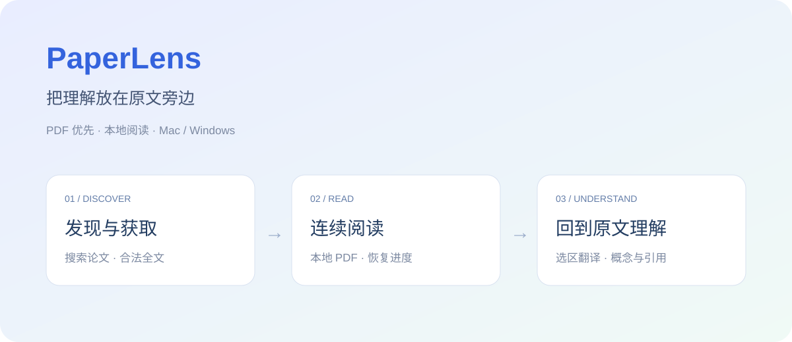

# PaperLens

PDF 优先、本地优先的文献阅读工作台。按「发现论文 → 合法获取 → 本地阅读 → 原文理解」完成一次科研阅读，把翻译、概念和引用线索放在原文旁边。

[](https://github.com/renjianfeixiu/paperlens/actions/workflows/ci.yml)
[](https://github.com/renjianfeixiu/paperlens/actions/workflows/release.yml)



当前版本：**v0.1.3 MVP**。源码基于 React、TypeScript、PDF.js 与 Tauri 2；提供 Mac 和 Windows 的原生桌面安装包。

## 下载后直接使用

**普通使用无需 Node、pnpm、Rust 或 Codex。** 打开 [最新版本下载页](https://github.com/renjianfeixiu/paperlens/releases/tag/v0.1.3-github)，按电脑类型下载安装包。

| 电脑 | 下载 | 安装方式 |
| --- | --- | --- |
| Mac：M1 / M2 / M3 / M4 等 Apple Silicon | [Apple Silicon DMG](https://github.com/renjianfeixiu/paperlens/releases/download/v0.1.3-github/PaperLens-0.1.3-macOS-AppleSilicon.dmg) | 打开 DMG，将 PaperLens 拖入 Applications |
| Mac：Intel 芯片 | [Intel DMG](https://github.com/renjianfeixiu/paperlens/releases/download/v0.1.3-github/PaperLens-0.1.3-macOS-Intel.dmg) | 打开 DMG，将 PaperLens 拖入 Applications |
| Windows 10 / 11：x64 | [Windows 安装程序](https://github.com/renjianfeixiu/paperlens/releases/download/v0.1.3-github/PaperLens-0.1.3-Windows-x64-setup.exe) | 双击安装，选择中文或英文，默认为当前用户安装 |

电脑型号可在 Mac 的「关于本机」或 Windows 的「设置 → 系统 → 系统信息」中查看。Windows 安装器在缺少 WebView2 时会联网安装运行环境。

这是未公证、未配置发布者证书的测试版本：Mac 使用本地 ad-hoc 签名，Windows 未做代码签名。构建测试与实际运行验收分开记录，详见 [平台验证记录](docs/RELEASE_VERIFICATION.md)。

## 先体验一次完整阅读

1. 在「发现」搜索论文标题、DOI 或 arXiv 编号，也可在资料库导入已有 PDF。
2. 检查题名、年份、来源和全文位置，使用开放获取渠道下载；机构订阅通过系统浏览器合法登录和下载。
3. 打开 PDF，翻页、跳页、缩放和选中文本；阅读进度随本地资料库保存。
4. 按需使用选区翻译、公式结构提示、通用概念解释和引用线索，回到原文核对。
5. 关闭并重新打开应用，继续阅读。搜索、下载、翻译与百科查询需要网络；已有本地 PDF 的基础阅读可离线使用。

## 已实现

- arXiv / DataCite、OpenAlex、Crossref 聚合检索，标题与 DOI 规范化、去重、来源和错误信息保留。
- CORE、Europe PMC、可选 Unpaywall 的全文位置补查；开放 PDF 下载，学校浏览器获取和用户核对后关联。
- 本地 PDF 导入、资料库、分页、页码跳转、缩放、文本选择和阅读进度恢复。
- 选区英中翻译、公式结构与符号提示、内置词条 / 维基百科概念解释，以及可核对的引用线索。
- 近期论文推荐、期刊检索与论文列表，Mac / Windows 对应快捷键。
- 同一版本的 Mac Apple Silicon、Mac Intel、Windows x64 构建流程、测试、安装包检查和校验值。

## 当前边界

- 这是科研阅读 MVP；笔记工作流、OCR、SQLite 全文索引、严格的上下文公式推导和真实大模型接入仍在后续计划中。
- 当前翻译使用 MyMemory，概念解释使用内置词条和维基百科。点击翻译会发送选区文字；点击概念查询会发送相应词条或必要的摘要文本。基础 PDF 阅读不会自动上传全文。
- 引用线索与公式提示采用启发式规则，应对照原文；通用概念释义不等于论文中的特定含义。
- 外部渠道可能限流或不可用，CORE 等来源不保证每次成功；只提供开放获取或用户已有权限的获取方式。
- Windows WebView2 界面、安装升级和卸载保留资料的实际验收，与 CI 构建及单元测试分开标明；不把安装包产出当作所有功能均已实机验证。
- 当前没有自动更新服务。升级前保留本地资料备份，从 Releases 下载新安装包。

## 修改源码时的开发入口

需要 Node.js 24、pnpm 11.25.0、Rust stable，以及对应系统的 Tauri 构建依赖。普通用户无需安装这些开发工具。

```sh
git clone https://github.com/renjianfeixiu/paperlens.git
cd paperlens/apps/desktop
pnpm install --frozen-lockfile
pnpm tauri dev
```

前端检查及原生测试：

```sh
pnpm test
pnpm build
cargo test --release --locked --manifest-path src-tauri/Cargo.toml
```

- Mac Apple Silicon：`pnpm tauri build --target aarch64-apple-darwin --bundles app,dmg -- --locked`
- Mac Intel：`pnpm tauri build --target x86_64-apple-darwin --bundles app,dmg -- --locked`
- Windows x64：`pnpm tauri build --target x86_64-pc-windows-msvc --bundles nsis -- --locked`

Mac、Windows 所需系统工具与步骤见 [Mac 构建说明](docs/MACOS_BUILD.md)、[Windows 构建说明](docs/WINDOWS_BUILD.md)。开发网页预览用于前端调试；文件导入、下载和本地保存需要原生桌面壳。

## 项目与版本

- [产品设计](docs/PRODUCT_DESIGN.md) · [实施阶段](docs/IMPLEMENTATION_STAGES.md) · [迭代路线](docs/ROADMAP.md)
- [参与开发](CONTRIBUTING.md) · [版本记录](CHANGELOG.md) · [GitHub 发布流程](docs/GITHUB_WORKFLOW.md)
- [本次发布说明](docs/releases/v0.1.3.md) · [平台验证记录](docs/RELEASE_VERIFICATION.md)
- 历史原生阅读回归：[macOS 0.1.3](docs/MACOS_0.1.3_REGRESSION.md)、[macOS 0.1.2](docs/MACOS_0.1.2_REGRESSION.md)。历史记录不替代新版本和其他平台的验收。

目录：`apps/desktop/src` 管理界面、领域数据和服务适配；`apps/desktop/src-tauri` 管理原生文件与网络；`scripts` 管理发布包校验；`docs` 保留产品决策、回归和发布记录。

`main` 用于持续开发，发布标签 `v0.1.3-github` 对应固定源码快照。查看本次版本：`git switch --detach v0.1.3-github`；回到开发分支：`git switch main`。用 `git revert <提交号>` 保留历史地撤销改动。
